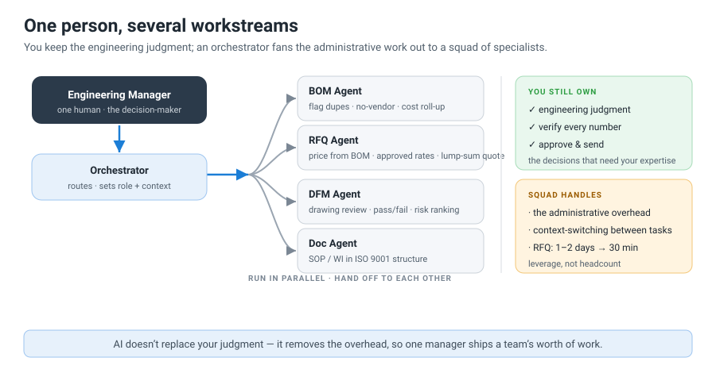

> **Update 2026-11-22** — The named specialist squad described here was retired in July 2026. The team now works with one orchestrator that does most work itself, short-lived helper agents, and a review by a model from a different vendor for risky changes. Agent-reported results are re-checked before use. [Part 3]() describes that setup. This article is kept as the record of the earlier design.

> **TL;DR** — A solo Engineering Manager can run NPI + RFQ + BOM + SOP + System Integration simultaneously by assigning specialized AI agents with clearly defined roles.

---


_The manager keeps the judgment; the squad absorbs the administrative overhead._

## The Solo Engineering Manager Problem

In Thai SMEs, an Engineering Manager often handles everything at once:
- Reviewing BOM from procurement
- Responding to customer RFQs
- DFM/DFA review with the design team
- Writing SOP/WI for ISO audits
- Monitoring production KPIs

**The result**: high context-switching → slow output → missed deadlines.

---

## The AI Squad Concept

Instead of using AI as a "chatbot that answers questions" — treat each agent as a **specialist** with a clearly defined role.

```
Engineering Manager (you)
        │
   ┌────┴────┐
   ▼         ▼
[BOM Agent] [RFQ Agent]    ← run in parallel
      │            │
[DFM Agent]  [Doc Agent]   ← can hand off to each other
```

---

## 4 Core Agents for NPI/SE

### 1. BOM Agent — Review & Cost Roll-up

**Prompt template:**
```
You are a PCBA BOM Engineer.
Given the BOM below: [paste BOM]
Please:
1. Flag duplicate reference designators
2. Flag components with no approved vendor
3. Roll up material cost with the overhead rate from your approved rate card
Output: table + summary
```

**Works with:** Excel BOM, Altium export, ERP BOM records

---

### 2. RFQ Agent — Quotation & Technical Scope

**Prompt template:**
```
You are an NPI Engineer preparing a customer quotation.
Scope: [paste spec/drawing summary]
Calculate price using:
- Material: [from BOM]
- Assembly: [placement count]
- OH: [rate from your approved rate card]
- Margin: [rate set by the person who approves quotations]
- NRE: [tooling list]
Output: English quotation, lump sum format
```

---

### 3. DFM Agent — Drawing Review for Manufacturability

**What to provide:**
- PDF drawing or screenshot
- Intended assembly process (SMT / THT / Wave)
- Target annual volume

**Output:**
- DFM checklist (pass / fail per item)
- Recommended changes with rationale
- Risk ranking

---

### 4. Doc Agent — SOP/WI to ISO Structure

**Prompt template:**
```
Write a Work Instruction for [process name]
following ISO 9001:2015 structure:
- Header: Doc No / Rev / Effective Date / Process Owner
- Purpose (1 paragraph)
- Scope
- Steps (numbered, action-oriented verbs)
- Quality checkpoint at every critical step
- Related documents
Language: English
```

---

## Real Setup in Use

### Claude Code (Primary)
- **Model**: Claude Sonnet 4.6
- **Use cases**: Complex analysis, BOM review, SOP writing, code
- **Cost**: ~$3/hr heavy use

### Gemini CLI (Secondary)
- **Use cases**: Browser-bound tasks, Google Workspace integration
- **Strength**: File reading from Google Drive, NotebookLM uploads

### NotebookLM (Knowledge Base)
- Upload all historical SOPs, drawings, and BOMs
- Query in natural language: "Have we done a project like this before?"
- Dramatically faster recall than searching folders

---

## Sample Workflow — New RFQ in 30 Minutes

```
1. Receive spec from customer           (5 min)
   ↓
2. BOM Agent: extract component list    (5 min)
   ↓
3. BOM Agent: query prices from ERP    (5 min)
   ↓
4. RFQ Agent: calculate + draft quote  (10 min)
   ↓
5. Review + approve + send             (5 min)
```

Previously: 1–2 days → now: 30 minutes.

---

## Tips from Experience

| Do | Don't |
|----|-------|
| Provide clear context (what engineering level?) | Ask vaguely: "help me with this BOM" |
| Always verify output, especially numbers | Blindly trust AI output |
| Use structured prompts (role + task + format) | Write free-form paragraphs |
| Include a sample output format | Just describe it in words |

---

## What We Did Not Measure

No before-and-after time study was kept for these tasks, so this article does not claim a time saving. If you want one, record task start and finish times for a few weeks before and after, on comparable jobs, and keep the AI's mistakes that a reviewer caught in the same log.

---

> The key insight: AI doesn't replace engineering judgment — it eliminates **administrative overhead**, freeing you to focus on the decisions that actually require your expertise.
