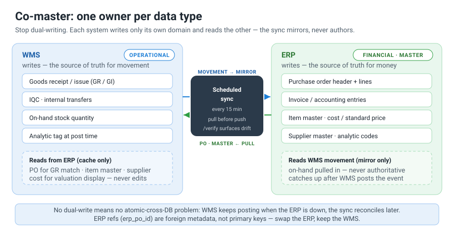

> **TL;DR** — Running two systems with overlapping inventory data always drifts. The co-master pattern assigns a clear owner to each data type: WMS owns operational movements (GR, GI, IQC, transfers), the ERP owns financial records (PO, invoice, cost, master data). Neither system should modify the other's domain.

---


_Give every data type one owner: WMS writes movement, the ERP writes money, and the sync mirrors &#8212; it never dual-writes._

## The Problem With Dual-Write

The instinct when building a WMS alongside an ERP is to keep both in sync by writing to both on every transaction. GR posted in WMS? Write it to the ERP too. Quantity adjusted? Update both.

This works until it doesn't. Every dual-write has a gap:

```
WMS write → SUCCESS
ERP write → TIMEOUT (network flap at receiving dock)

Result: WMS qty = 100, ERP qty = 0
```

In a warehouse running 30–50 GR transactions a day, a 1% network error rate means a divergence every few days. Each divergence is invisible until someone runs a reconciliation report — usually after a financial audit or a customer complaint.

The root cause isn't the network. It's the architecture: you've made correctness dependent on two writes succeeding atomically, without a distributed transaction coordinator. That's not achievable across two separate databases owned by different vendors.

---

## The Co-Master Split

The fix is to stop treating inventory as shared. Each system owns certain data types exclusively. The other system reads but never writes to those types.

| Data Type | Owner | The Other System Does |
|-----------|-------|-----------------------|
| Inventory movement (GR/GI/transfer) | **WMS** | ERP mirrors via scheduled sync |
| Stock quantity (on-hand) | **WMS** | ERP reads via pull; never authoritative |
| Purchase Order header + lines | **ERP** | WMS reads for GR matching |
| Invoice / accounting entries | **ERP** | WMS never touches |
| Item master (description, UOM, category) | **ERP** | WMS caches, never edits |
| Cost / standard price | **ERP** | WMS uses for valuation display only |
| Analytic codes (project, department) | **ERP** | WMS tags transactions at post time |
| Supplier master | **ERP** | WMS reads for GR supplier field |

Once ownership is explicit, the failure modes simplify: WMS operations can proceed even when the ERP is unreachable, because WMS doesn't need the ERP to confirm its own movements. The sync catches up when the ERP comes back.

---

## Pull Direction: Always Pull Before Push

The most common mistake in setting up the sync layer is writing to WMS first and pulling from the ERP second — or pulling lazily (on demand, when a user searches for a PO).

Pull must happen upstream of every WMS write that references ERP data:

```
Before GR:  pull PO from ERP → validate PO exists + open
            → post GR in WMS
            → queue ERP mirror (async)
```

A hosted ERP is usually rate-limited. Burst-writing to it after every WMS event triggers 429s and temporary bans. The scheduler should run on a fixed cadence — every 15 minutes is enough for most manufacturing operations — rather than per-event.

If a GR is posted against a PO that hasn't been pulled yet, you get an orphan record: the WMS knows the GR happened but can't link it to a financial document. These accumulate silently and surface only at month-end reconciliation.

---

## The Verify Page

Drift between WMS and the ERP is not always an error. ERP-side operations — MO component consumption, customer returns, inventory adjustments made directly in the ERP by accounting — move stock without WMS knowing. The sync runs on a schedule, so there's always a window.

The solution isn't to prevent drift; it's to make it visible.

A `/verify` page compares WMS `on_hand` quantity with the ERP's on-hand quantity for each SKU. It shows:
- Items in sync (green)
- Items with expected lag (within sync window — grey)
- Items with unexplained divergence (red — needs investigation)

The key distinction is **drift = expected** vs **drift = a bug**. A SKU that the ERP consumed via an MO two hours ago and WMS hasn't synced yet is expected drift. A SKU where WMS shows 100 and the ERP shows 0 with no recent ERP operations is a bug.

The verify page is a reconciliation surface, not an error dashboard. Showing it to operators without context causes false alarms. Show it to the system team on a schedule.

---

## What Breaks Co-Master

**Direct database edits.** A developer who fixes a quantity discrepancy by running `UPDATE t_inventory_uids SET qty = 100 WHERE sku = 'ABC'` has bypassed every sync hook. The WMS now shows 100; the ERP still shows whatever it showed before; the movement has no audit trail.

**ERP batch operations without sync notification.** When a production planner runs an MO that consumes 500 components in the ERP, the sync scheduler needs to pick this up within its window. If the scheduler is broken or paused, the divergence grows with every MO.

**WMS reading ERP accounting fields.** The ERP's accounting module exposes invoices, journal entries, and payment state through its API — but the field names and access rules change between ERP versions, and the API rate limits apply. Attempting to surface payment status in WMS by querying ERP accounting fields creates a fragile dependency. Accounting state belongs in the AP tracker, not the WMS.

---

## Sunset Vision

The co-master architecture is built with ERP removability in mind. WMS data structures use ERP references (`erp_po_id`, `erp_partner_id`) as foreign metadata, not as primary keys. If the ERP is replaced with another one or a custom system, the WMS continues operating and the sync layer gets a new adapter — the WMS schema doesn't change.

This matters because ERP migrations are expensive and disruptive. Any WMS that hardcodes ERP record IDs as primary keys is effectively locked to that ERP. The co-master split, properly implemented, keeps the options open.
