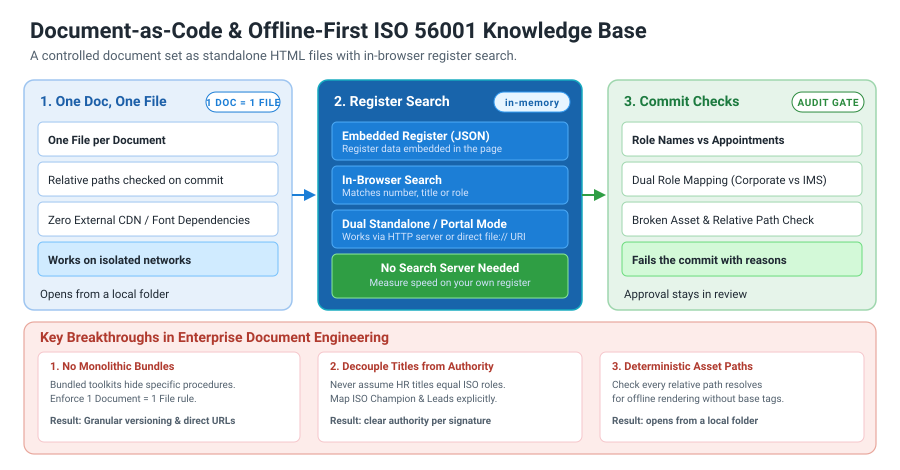

> **TL;DR** — A management-system document set (ISO 56001 innovation management, ISO 9001 quality) becomes hard to use when it is spread across Word files, PDFs and links that break. The "Document-as-Code" approach keeps each controlled document as one standalone HTML file under version control, with no external dependencies, a small in-browser search over the document register, and automated checks on every commit for links, assets and role names.

---


_Version-controlled, one-file-per-document records with an in-browser register search._

All document numbers, titles, paths and role names below are **fictional**. Clause references are left out of the examples: take them from the organization's own clause map for the edition of the standard it applies.

_Revised 2026-11-23: document counts, timings and internal document details were removed; the search description and the lint example were corrected._

## The Documentation Problem

Organizations that run a management system (ISO 9001 quality, ISO 14001 environment, ISO 56001 innovation management) maintain many controlled documents, typically following the standards' common clause structure:

- Policies, context and leadership records (Clauses 4 and 5)
- Risk and opportunity registers, objectives and plans (Clause 6)
- Competence records, training plans and knowledge registers (Clause 7)
- Innovation initiative and project records (Clause 8)
- Internal audit checklists, nonconformity reports and lessons learned (Clauses 9 and 10)
- Departmental procedures and process flowcharts

A common approach is to keep `.docx` or `.pdf` files in shared folders. During an audit this causes predictable problems:

1. **Slow discovery:** finding the record an auditor asks for, and who approved it, means searching through folder trees.
2. **Broken cross-references:** documents refer to superseded document numbers or organization charts.
3. **Restricted networks:** some audit rooms or sites have limited internet access, so a portal that loads fonts or scripts from external CDNs can render without styles or fail.

---

## The Document-as-Code Architecture

The document set becomes a repository of standalone files, checked on every commit and published as a static site that also works from a local folder:

```
                            +-------------------------------------+
                            |      DOCUMENT-AS-CODE REPOSITORY    |
                            +------------------+------------------+
                                               |
             +----------------+----------------+----------------+----------------+
             |                |                |                |                |
             v                v                v                v                v
      +--------------+ +--------------+ +--------------+ +--------------+ +--------------+
      | 01-System/   | | 02-Registers/| | 03-Forms/    | | 04-Projects/ | | 05-Depts/    |
      | Procedures   | | Controlled   | | One form     | | Project and  | | SOPs and     |
      |              | | registers    | | per file     | | gate records | | flowcharts   |
      +-------+------+ +-------+------+ +-------+------+ +-------+------+ +-------+------+
              |                |                |                |                |
              +----------------+----------------+----------------+----------------+
                                               |
                                               v
                             +-----------------------------------+
                             |       CHECKS ON EVERY COMMIT      |
                             | - Links and asset paths resolve   |
                             | - No external dependencies        |
                             | - Role names match appointments   |
                             | - Register index rebuilt          |
                             +-----------------+-----------------+
                                               |
                                               v
                             +-----------------------------------+
                             |        OUTPUT: STATIC SITE        |
                             |  - register search page           |
                             |  - standalone .html documents     |
                             +-----------------------------------+
```

---

## 1. One Document, One File

A common anti-pattern is the "pack" or "toolkit": one long document containing several procedures, checklists and forms. When an auditor asks for one form, a bundle makes it unclear which revision and approval apply to that form.

The rule is **one controlled document per file**:

- **Forms:** each form is its own file with its own number, for example `DEMO-FM-101` and `DEMO-FM-102`.
- **Procedures:** a procedure that covered several scopes (for example design verification, nonconformity control and management review) is split into separate procedures, each with its own owner and revision.

Every document carries its number, revision, effective date and approval in a standard header:

```html
<!-- Document header pattern (fictional values) -->
<div class="doc-header">
  <div class="header-left">
    <div class="org-title">EXAMPLE CO., LTD.</div>
    <div class="doc-title-en">Reusable Knowledge &amp; Asset Register</div>
  </div>
  <div class="header-right">
    <table class="meta-table">
      <tr><td>Doc No:</td><td><strong>DEMO-REG-001</strong></td></tr>
      <tr><td>Rev:</td><td><strong>B</strong></td></tr>
      <tr><td>Effective:</td><td><strong>YYYY-MM-DD</strong></td></tr>
      <tr><td>Clause:</td><td><strong>(from the clause map)</strong></td></tr>
    </table>
  </div>
</div>
```

The header shows the release record; it does not replace it. Approval and release still follow the [document release workflow]().

---

## 2. Offline-First Rendering

So that documents open from a local folder or an isolated file server without internet access:

1. **No external dependencies:** styles live in a local stylesheet, and fonts use system font stacks (`-apple-system`, `BlinkMacSystemFont`, `Segoe UI`, `Roboto`, `Tahoma`).
2. **Relative paths that resolve:** shared assets are linked with relative paths (`../../_ds/app.css`), and a check confirms that every path resolves to a file in the repository.
3. **No client-side routing:** each document opens directly from `file:///` in a current browser, without a local web server.

---

## 3. In-Browser Register Search

The register of documents (number, title, role, path) is embedded in the search page as a JSON array. For a register of a few hundred entries, a simple linear filter in the browser is enough; no search server or database is needed.

```javascript
// Register search page: the register is embedded, so it also works from file:///
const DOC_REGISTRY = [
  { id: "DEMO-REG-001", title: "Reusable Knowledge & Asset Register", role: "Knowledge Manager", path: "02-Registers/DEMO-REG-001.html" },
  { id: "DEMO-GDE-002", title: "Knowledge Management Guide", role: "Knowledge Manager", path: "05-Depts/DEMO-GDE-002.html" },
  { id: "DEMO-PRJ-003", title: "Example Project Lessons Learned Register", role: "Engineering Lead", path: "04-Projects/DEMO-PRJ-003.html" },
  // ... one entry per controlled document
];

function searchRegister(query) {
  const q = query.trim().toLowerCase();
  if (!q) return DOC_REGISTRY;
  return DOC_REGISTRY.filter(doc =>
    [doc.id, doc.title, doc.role].some(field => field.toLowerCase().includes(q))
  );
}
```

This is a substring match, not fuzzy search or an inverted index. Measure the response on your own register before claiming a speed. Typing a document number, a word from a title or a role name narrows the list and links straight to the standalone document.

---

## 4. Automated Governance Checks

A check script runs as a pre-commit hook and again in CI. Three useful rules:

```python
#!/usr/bin/env python3
"""Check standalone HTML documents and their stylesheets for external dependencies,
broken links and role names. Place this script at the repository root."""
import pathlib
import re
import sys
from urllib.parse import unquote, urlsplit

REPO = pathlib.Path(__file__).resolve().parent

# Places a document can load or link a file from: href/src attributes (quoted or not),
# srcset candidate lists, CSS url(...) and CSS @import "...".
ATTR = re.compile(r"""\b(?:href|src)\s*=\s*(?:"([^"]*)"|'([^']*)'|([^\s"'>]+))""", re.IGNORECASE)
SRCSET = re.compile(r"""\bsrcset\s*=\s*["']([^"']+)["']""", re.IGNORECASE)
CSS_URL = re.compile(r"""url\(\s*["']?([^"')\s]+)""", re.IGNORECASE)
CSS_IMPORT = re.compile(r"""@import\s+["']([^"']+)["']""", re.IGNORECASE)

# Role names as written in the appointment order (fictional examples).
REGISTERED_ROLES = {"IMS Manager", "Knowledge Manager", "Quality Assurance Lead"}
ROLE_FIELD = re.compile(r'data-role="([^"]+)"')


def references(content: str) -> list[str]:
    refs = ["".join(groups) for groups in ATTR.findall(content)]
    refs += CSS_URL.findall(content) + CSS_IMPORT.findall(content)
    for candidates in SRCSET.findall(content):
        if not candidates.lstrip().startswith("data:"):
            refs += [c.split()[0] for c in candidates.split(",") if c.strip()]
    return refs


def check_document(path: pathlib.Path) -> list[str]:
    errors = []
    content = path.read_text(encoding="utf-8")

    for ref in references(content):
        parts = urlsplit(ref)
        # Rule 1: no external dependencies (http, https or protocol-relative URLs)
        if parts.scheme in ("http", "https") or ref.startswith("//"):
            errors.append(f"external reference: {ref}")
            continue
        if parts.scheme or not parts.path:   # mailto:, data:, or a "#section" link in the same file
            continue
        # Rule 2: every relative link or asset resolves to a file in the repository
        target = (path.parent / unquote(parts.path)).resolve()
        if REPO not in target.parents or not target.exists():
            errors.append(f"broken link or asset: {ref}")

    # Rule 3: role names in signature blocks match the appointment order
    for role in ROLE_FIELD.findall(content):
        if role not in REGISTERED_ROLES:
            errors.append(f"role not in the appointment order: {role}")

    return errors


if __name__ == "__main__":
    failed = False
    for doc in sorted([*REPO.rglob("*.html"), *REPO.rglob("*.css")]):
        for error in check_document(doc):
            print(f"{doc.relative_to(REPO)}: {error}")
            failed = True
    sys.exit(1 if failed else 0)
```

The check stops the commit with a reason for each problem. It reads `href` and `src` attributes, `srcset` lists, and CSS `url(...)` and `@import` in HTML and CSS files. It does not run scripts, so a URL that JavaScript builds at runtime is not caught; review scripts for that. It confirms that links resolve and names match. Whether the content is correct and approved is decided in review.

---

## Governance Principles

1. **Separate job titles from management-system roles:** a job title such as "Engineering Manager" does not by itself make someone the IMS Manager. Record each appointment in an appointment order, and show both the job title and the appointed role in signature blocks.
2. **Do not invent numbers for placeholders:** leave approval limits or budgets that depend on live company policy as a reference to the controlling document, for example `[See authorization matrix]`, rather than typing an example figure that could be read as policy.
3. **Keep the checks executable:** when every document is a separate file, checked on every commit and findable from the register, the document set stays usable between audits as well as during them.

---

## Production Hardening Checklist

```
[ ] 1. ONE DOCUMENT PER FILE
       Split bundled toolkits and multi-procedure manuals into standalone,
       individually numbered and revised files.

[ ] 2. NO EXTERNAL DEPENDENCIES
       Keep styles and fonts local so documents render on isolated networks
       and from a local folder.

[ ] 3. EMBEDDED REGISTER SEARCH
       Embed the register as JSON in the search page; measure response time
       on the real register before stating it.

[ ] 4. CHECKS ON EVERY COMMIT
       Links and asset paths resolve, no external references, and role names
       match the appointment order.

[ ] 5. JOB TITLE AND APPOINTED ROLE
       Show both in every signature block.
```

---

## Related Posts

- [Can We Release This Procedure Revision? Document Control as a Workflow, Not a Folder]() &#8212; the release decision this document set supports.
- [SOP Hierarchy: When to Write a Procedure vs. a Work Instruction]() &#8212; deciding which level a document belongs at.
- [SOP Revamp Playbook — 13 Principles for SOPs That Actually Get Used]() &#8212; rewriting procedures people follow.
- [A Five-Section Kaizen Report for an Evidence-Based Decision]() &#8212; recording an improvement with its evidence.
