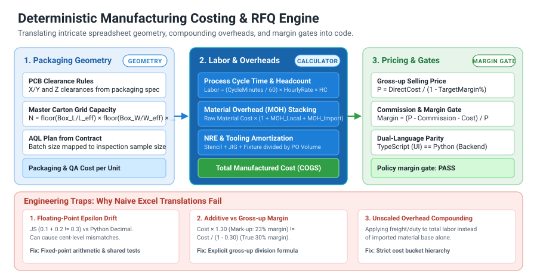

> **TL;DR** — EMS quotations are often built in spreadsheets that mix packaging geometry, inspection sampling, material overheads and margin rules. Moving those rules into code makes them repeatable only if each rule has a stated source, the edge cases fail loudly, money is computed in decimal arithmetic, and the price, commission and margin formulas agree with each other.

---


_From spreadsheets to software: geometry rules, overheads and pricing policy as code with stated sources._

All dimensions, rates and percentages below are **fictional examples**. Take real values from the packaging specification, the customer's quality agreement and the organization's pricing policy.

_Revised 2026-11-23: unmeasured figures and internal names were removed; the carton capacity, margin and floating-point examples were corrected._

## The Fragility of Spreadsheet-Driven Quotations

In electronics manufacturing services (EMS) and New Product Introduction (NPI), a quotation for a Request for Quote (RFQ) is not a simple sum of component prices. A quote combines several cost layers:

1. **Bill of Materials (BOM) Cost:** component pricing, scrap allowances and minimum order quantity (MOQ) effects.
2. **Material Overhead (MOH):** logistics, import duties and handling applied to materials.
3. **Packaging & Logistics Geometry:** how many finished boards fit in a master carton.
4. **Labor & Process Engineering:** SMT cycle time, manual operations, and test time at ICT/FCT.

Estimators often keep these rules in a workbook with macros and hidden cells. That is flexible, but it carries risks:

- **Formula drift:** copies of the workbook diverge, so two estimators can price the same PCBA differently.
- **Markup vs. margin confusion:** an additive markup ($C \times 1.30$) gives a lower margin than a gross-up ($C / (1 - 0.30)$).
- **No revision history:** it is unclear why a quote changed between Revision A and Revision B.

---

## 1. Physical Geometry: Master Carton Capacity

A common manual shortcut is to divide a carton price by a guessed number of units (e.g., "50 pcs per box").

Carton capacity depends on board dimensions, component height, and the packing method. The grid calculation below is a simple estimate: it places every board in one orientation, in rows, columns and layers. Packing the boards another way can fit more, so the packaging specification or a trial pack decides the released figure.

```
       +-------------------------------------------------------------+
       |                     MASTER CARTON (L x W x H)               |
       |                                                             |
       |     +----------+  +----------+  +----------+                |
       |     |  PCB #1  |  |  PCB #2  |  |  PCB #3  |  ... (Grid X)  |
       |     +----------+  +----------+  +----------+                |
       |                                                             |
       |     (Grid Y)                                                |
       |     +----------+  +----------+  +----------+                |
       |     |  PCB #4  |  |  PCB #5  |  |  PCB #6  |                |
       |     +----------+  +----------+  +----------+                |
       |                                                             |
       +-------------------------------------------------------------+
```

### The Clearance and Capacity Calculation

Let the raw PCB dimensions be Length ($L$), Width ($W$), and Thickness ($T$), with the tallest component height on top ($H_{\text{top}}$) and bottom ($H_{\text{bot}}$).

1. **Effective dimensions with clearances** (example values; take real ones from the packaging specification):
   - X/Y clearance allowance: $c_{xy} = 2.0\%$
   - Z clearance allowance (bag, cushion or divider): $c_z = 20.0\%$

$$L_{\text{eff}} = L \times (1 + c_{xy})$$

$$W_{\text{eff}} = W \times (1 + c_{xy})$$

$$H_{\text{eff}} = (T + H_{\text{top}} + H_{\text{bot}}) \times (1 + c_z)$$

2. **Grid capacity within the master box ($B_L, B_W, B_H$):**

$$N_x = \left\lfloor \frac{B_L}{L_{\text{eff}}} \right\rfloor, \quad N_y = \left\lfloor \frac{B_W}{W_{\text{eff}}} \right\rfloor, \quad N_z = \left\lfloor \frac{B_H}{H_{\text{eff}}} \right\rfloor$$

$$\text{Total Units Per Box } (N_{\text{box}}) = N_x \times N_y \times N_z$$

3. **Packaging cost per finished unit** (defined only when $N_{\text{box}} \ge 1$):

$$\text{Cost}_{\text{packaging}} = \frac{\text{Cost}_{\text{carton}} + \text{Cost}_{\text{divider}} + (\text{Cost}_{\text{bag}} \times N_{\text{box}})}{N_{\text{box}}}$$

```python
import math
from decimal import Decimal


class PackagingError(ValueError):
    """The board does not fit the carton; a person must choose another carton or method."""


def compute_master_carton_capacity(
    pcb_length_mm: Decimal,
    pcb_width_mm: Decimal,
    pcb_total_height_mm: Decimal,
    box_length_mm: Decimal,
    box_width_mm: Decimal,
    box_height_mm: Decimal,
    clearance_xy: Decimal,   # e.g. Decimal("0.02") from the packaging specification
    clearance_z: Decimal,    # e.g. Decimal("0.20")
) -> int:
    """Grid estimate for one orientation. Never returns 0 silently."""
    for name, value in (("pcb_length_mm", pcb_length_mm), ("pcb_width_mm", pcb_width_mm),
                        ("pcb_total_height_mm", pcb_total_height_mm)):
        if value <= 0:
            raise PackagingError(f"{name} must be positive: {value}")

    l_eff = pcb_length_mm * (1 + clearance_xy)
    w_eff = pcb_width_mm * (1 + clearance_xy)
    h_eff = pcb_total_height_mm * (1 + clearance_z)

    nx = math.floor(box_length_mm / l_eff)
    ny = math.floor(box_width_mm / w_eff)
    nz = math.floor(box_height_mm / h_eff)

    capacity = nx * ny * nz
    if capacity < 1:
        raise PackagingError(
            f"board does not fit this carton in this orientation (nx={nx}, ny={ny}, nz={nz})"
        )
    return capacity
```

Do not replace a zero with one. A capacity of one for a board that does not fit puts a whole carton's cost on each unit, and the quote looks valid when it is not.

---

## 2. Inspection Sampling: Take the Plan from the Standard and the Contract

Inspection labor depends on the sample size, which depends on the lot size, the inspection level and the acceptance quality limit (AQL). Under ISO 2859-1 (ANSI/ASQ Z1.4 is the comparable US standard), the lot size and inspection level give a code letter, and the code letter and AQL give the sample size and the accept and reject numbers.

- **Take the AQL and inspection level from the customer agreement or the quality plan.** They differ between customers and between characteristics, so do not hard-code one AQL for every quote.
- **Store the plan as data with its source:** the standard, its edition, the table used, the inspection level and the AQL.
- **Follow the arrows.** In the standard's master tables, some combinations of code letter and AQL point to a different sample size. A lookup that reads the nearest row without following the arrow gives a wrong sample size.

$$\text{QA labor cost per unit} = \frac{n \times \text{inspection time per sample}}{\text{lot size}} \times \text{hourly QA rate}$$

---

## 3. Financial Mathematics: Markup vs. Gross-Up Margin

A common pricing error in custom manufacturing software is confusing **markup** with **gross margin**.

```
+-----------------------------------------------------------------------------+
|                           MARKUP VS. GROSS-UP                               |
|                                                                             |
|   Direct Cost (C) = $100.00                                                 |
|   Desired Margin  = 30%                                                     |
|                                                                             |
|   [ X ] Mark-up Formula:                                                    |
|         Price = Cost * (1 + 0.30) = $130.00                                 |
|         Realized Margin = ($130 - $100) / $130 = 23.08%  (6.92 points short)|
|                                                                             |
|   [ V ] Gross-up Formula:                                                   |
|         Price = Cost / (1 - 0.30) = $142.86                                 |
|         Realized Margin = ($142.86 - $100) / $142.86 = 30.00%               |
+-----------------------------------------------------------------------------+
```

### Price, Commission and Margin

Let direct material cost be $M$, material overhead rate $r_{\text{moh}}$, direct labor $L$, manufacturing overhead $O$, sales commission rate $r_{\text{comm}}$ (a share of the selling price), and target margin $r_{\text{margin}}$.

1. **Direct cost base ($C_{\text{direct}}$):**

$$C_{\text{direct}} = \left( M \times (1 + r_{\text{moh}}) \right) + L + O$$

2. **Base selling price ($P_{\text{base}}$):**

$$P_{\text{base}} = \frac{C_{\text{direct}}}{1 - r_{\text{margin}}}$$

3. **Commission-inclusive final selling price ($P_{\text{final}}$):**

$$P_{\text{final}} = \frac{P_{\text{base}}}{1 - r_{\text{comm}}}$$

4. **Margin after commission**, the figure a policy gate should check:

$$\text{Margin after commission} = \frac{P_{\text{final}} - r_{\text{comm}} \times P_{\text{final}} - C_{\text{direct}}}{P_{\text{final}}} = r_{\text{margin}} \times (1 - r_{\text{comm}})$$

With $C_{\text{direct}} = 100$, $r_{\text{margin}} = 30\%$ and $r_{\text{comm}} = 5\%$: $P_{\text{final}} = 150.38$ and the margin after commission is $28.5\%$, not $30\%$. A gate that leaves out the commission reports $33.5\%$ and can pass a quote that the policy should stop. Note also that $C_{\text{direct}}$ here includes manufacturing overhead, so this is a gross margin. Call it a contribution margin only if the cost base contains variable costs alone.

{: .prompt-info }
> **Policy gate:** the minimum margin is a pricing-policy value, not a constant in the code. Store it as configuration with its owner and effective date. When a quote falls below it, the engine blocks release and routes the quote to the approver the policy names.

---

## 4. Dual-Language Parity: TypeScript vs. Python

Web applications often compute pricing in two places:

1. **Frontend (TypeScript):** interactive quote feedback in the browser.
2. **Backend (Python):** stored results, quotation documents and downstream records.

### The Floating-Point Trap

JavaScript numbers are IEEE-754 binary doubles. Python's `decimal.Decimal` stores decimal digits exactly.

```javascript
// JavaScript
0.1 + 0.2;            // 0.30000000000000004
(1.005).toFixed(2);   // "1.00": 1.005 is stored as 1.00499999...
```

```python
# Python
from decimal import Decimal, ROUND_HALF_UP
Decimal("1.005").quantize(Decimal("0.01"), ROUND_HALF_UP)   # Decimal('1.01')
```

A one-cent difference on a unit price is multiplied by the order quantity. Two other sources of mismatch are as common as binary floats:

- **Different input precision:** a unit price kept as `1.42857` in one engine and `1.4285714` in the other gives totals for 100,000 units of 142,857.00 and 142,857.14.
- **Different rounding points:** rounding each line before summing gives a different total from summing first and rounding once.

Decide where rounding happens and with which rule, write it in the specification, and make both engines follow it.

### The Parity Architecture

```
[ Frontend: TypeScript Engine ] <--- Shared JSON Fixture ---> [ Backend: Python Engine ]
     (decimal.js library)              (shared test cases)         (Python decimal.Decimal)
```

1. **Use `decimal.js` or `bignumber.js` on the frontend:** do not use native `+` or `*` for money.
2. **Shared parity tests:** one JSON file of cases (zero volumes, boards that do not fit the carton, extreme aspect ratios, currency conversion, values that sit exactly on a rounding boundary) runs in both the JavaScript test runner and `pytest`.

```typescript
// Shared pricing module (TypeScript)
import { Decimal } from 'decimal.js';

export function computeGrossUpPrice(
  directCost: Decimal,
  targetMarginRate: Decimal,
  commissionRate: Decimal
): Decimal {
  const one = new Decimal(1);
  const basePrice = directCost.dividedBy(one.minus(targetMarginRate));
  const finalPrice = basePrice.dividedBy(one.minus(commissionRate));
  return finalPrice.toDecimalPlaces(4, Decimal.ROUND_HALF_UP);
}
```

---

## Production Hardening Checklist

```
[ ] 1. NO NATIVE FLOATS FOR MONEY
       Decimal types in the frontend (decimal.js), backend (Python Decimal)
       and database (NUMERIC with an agreed scale).

[ ] 2. GROSS-UP DIVISION, NOT ADDITIVE MARKUP
       Price = Cost / (1 - Margin), never Cost * (1 + Margin).

[ ] 3. MARGIN GATE AFTER COMMISSION
       The gate checks margin after commission against a configured policy
       value with an owner and effective date.

[ ] 4. MATERIAL OVERHEAD ON MATERIALS ONLY
       Apply import freight and duty to the material base, not to
       assembly or test labor.

[ ] 5. SAMPLING PLAN AS SOURCED DATA
       AQL and inspection level come from the customer agreement or quality
       plan; store the standard, edition and table with the plan.

[ ] 6. FAIL LOUDLY ON IMPOSSIBLE GEOMETRY
       A board that does not fit the carton stops the quote with a reason;
       it never becomes a capacity of one.

[ ] 7. DUAL-ENGINE PARITY TESTS
       The same JSON cases run against the TypeScript and Python engines in CI.
```

---

## Related Posts

- [PCBA RFQ Costing: Build a Traceable Quote Basis]() &#8212; baseline cost breakdown for printed circuit assembly.
- [PCBA RFQ Intake: Define the Build Before Pricing It]() &#8212; fixing the scope a quote covers before pricing it.
- [Sizing a PCB from Gerbers for an RFQ: What the Files Can Establish]() &#8212; board size, layer count and finish from the fabrication files.
- [When One Status Column Isn't Enough: Splitting Orthogonal State Machines]() &#8212; modeling quotation approval states.
