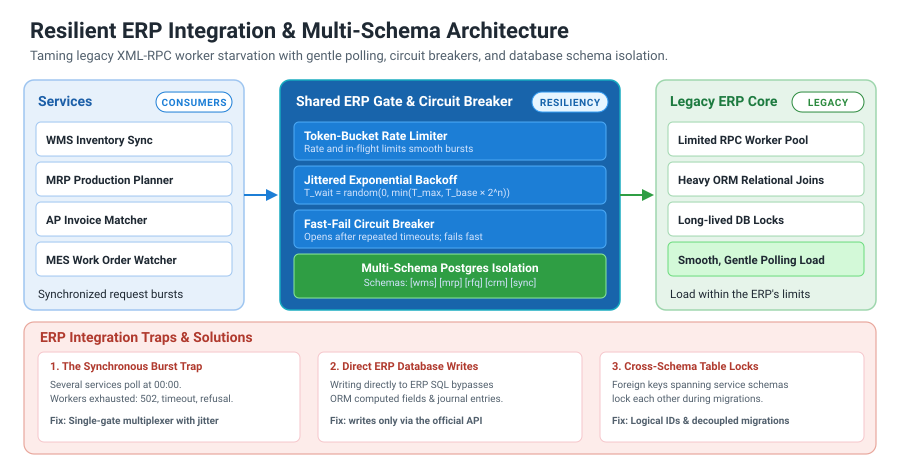
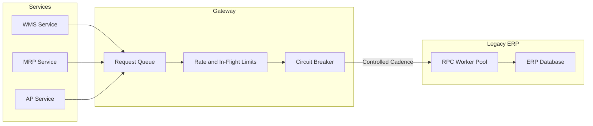

> **TL;DR** — When several services poll one ERP on the same schedule, their requests can arrive together and exhaust its small worker pool. Simple retries make that worse. Put one gateway in front of the ERP that limits request rate and requests in flight, retries with jittered backoff, and stops calling while the ERP is unavailable. Give each service its own database schema so that one service's migration does not lock another's tables.

---


_Replacing synchronized burst polling with one gateway that limits load, and isolating service schemas._

The timings, limits and counts in this post are **illustrative**. Set real limits from the ERP owner's guidance and from measurements on the system involved.

_Revised 2026-11-23: unmeasured figures were removed, rate and concurrency limits are now separated, and the backoff and database-role examples were corrected._

## The Legacy ERP Bottleneck

Modern architectures often split business functions into separate services: a WMS for barcode scanning, an MRP engine for material scheduling, a CRM for opportunities, and an AP tracker for three-way invoice matching.

These services still exchange data with a central ERP (for example an open-source ERP, SAP or an AS/400-based system). Many such ERPs expose synchronous RPC endpoints (XML-RPC, JSON-RPC or SOAP) served by a limited pool of workers, designed for users submitting one form at a time.

When several services run scheduled synchronization at the same moment, the ERP receives a burst it was not sized for:

```
[ WMS Sync Cron ] --- (many RPCs at 00:00) ---> +-----------------------+
[ MRP Plan Cron ] --- (many RPCs at 00:00) ---> |   LEGACY ERP ENGINE   |
[ AP Match Cron ] --- (many RPCs at 00:00) ---> | (small worker pool)   |
[ MES Hook Sync ] --- (many RPCs at 00:00) ---> +-----------+-----------+
                                                            |
                                                  [ WORKER STARVATION ]
                                                  [ 502 / 503 / 504 / TIMEOUT ]
```

Developers often report this as *"the ERP crashed or refused the connection."* Usually the ERP is still running: its workers are busy and new requests wait in a queue. What the client then sees depends on the components in between. A reverse proxy may return 502, 503 or 504, and a client may time out. A refused connection usually means nothing is listening on that port; when a server's accept queue is full, Linux by default drops the new connection, and the client sees a connect timeout rather than a refusal. Read the exact error and where it came from before choosing a fix.

---

## The Burst Refusal Pattern

An illustrative sequence shows why simple retry loops make this worse:

```
Step  Event (illustrative)
-------------------------------------------------------------------------------
1     Scheduled jobs in several services start at the same minute.
2     Their requests reach the ERP together; every worker becomes busy.
3     New requests queue at the proxy or the ERP; some time out or are refused.
4     Each service retries at once, adding a second wave while the first is
      still being processed.
5     Queues grow, more requests time out, and the retries repeat.
```

Retrying immediately turns a short overload into a retry storm generated by your own services.

---

## The Gentle Polling Architecture

Route ERP calls from all services through **one gateway** that applies three controls:



### 1. Limit Rate and Requests in Flight Separately

Two limits answer different questions:

- **Rate** (requests per second, with a burst allowance) controls how fast new requests start. A token bucket implements it.
- **Requests in flight** (concurrency) controls how many requests are open at once. A semaphore implements it.

A rate limit alone does not cap concurrency. At 5 requests per second, slow calls of 4 seconds each can still leave 20 requests open at once, more than a small worker pool can serve. Set both limits from the ERP owner's guidance and from measured response times.

```python
import threading
import time
from contextlib import contextmanager


class TokenBucketRateLimiter:
    """Rate limit: tokens refill at `rate_per_second`, up to `capacity` (the burst)."""

    def __init__(self, rate_per_second: float, capacity: float):
        if rate_per_second <= 0 or capacity < 1:
            raise ValueError("rate must be positive and capacity at least 1")
        self.rate = rate_per_second
        self.capacity = capacity
        self.tokens = capacity
        self.last_update = time.monotonic()
        self.lock = threading.Lock()

    def acquire(self, tokens_needed: float = 1.0) -> None:
        if tokens_needed > self.capacity:
            raise ValueError("tokens_needed exceeds bucket capacity; it would wait forever")
        while True:
            with self.lock:
                now = time.monotonic()
                self.tokens = min(self.capacity, self.tokens + (now - self.last_update) * self.rate)
                self.last_update = now
                if self.tokens >= tokens_needed:
                    self.tokens -= tokens_needed
                    return
                wait_time = (tokens_needed - self.tokens) / self.rate
            time.sleep(wait_time)


class ErpGate:
    """Every ERP call first takes a free in-flight slot, then waits for the rate limit."""

    def __init__(self, rate_per_second: float, burst: float, max_in_flight: int):
        self.rate_limiter = TokenBucketRateLimiter(rate_per_second, burst)
        self.in_flight = threading.BoundedSemaphore(max_in_flight)

    @contextmanager
    def slot(self):
        with self.in_flight:
            self.rate_limiter.acquire()
            yield
```

### 2. Exponential Backoff with Full Jitter

When a call fails for a transient reason (timeout, refused connection, 502/503/504), wait before retrying, and spread the waits randomly so that clients do not retry in step. With full jitter, the wait is a random value between zero and the exponential ceiling:

$$T_{\text{wait}} = \text{random}\left(0,\; \min\left(T_{\max},\; T_{\text{base}} \times 2^{\text{attempt}}\right)\right)$$

```python
import random
import time
from typing import Any, Callable

RETRYABLE = (ConnectionRefusedError, TimeoutError)  # add the client library's 502/503/504 errors


def execute_with_jittered_backoff(
    rpc_func: Callable[[], Any],
    max_attempts: int = 5,
    base_delay: float = 1.0,
    max_delay: float = 30.0,
) -> Any:
    for attempt in range(max_attempts):
        try:
            return rpc_func()
        except RETRYABLE:
            if attempt == max_attempts - 1:
                raise
            ceiling = min(max_delay, base_delay * (2 ** attempt))
            time.sleep(random.uniform(0, ceiling))
```

Retry only calls that are safe to repeat. A write that may have been applied before the timeout needs an idempotency key or a check of the ERP state before it is sent again.

### 3. Fast-Fail Circuit Breakers

If the ERP is down for maintenance or backup, services should stop sending requests and fail quickly instead of hanging. A circuit breaker has three states (the thresholds are examples):

- **CLOSED (normal):** requests pass to the ERP.
- **OPEN (tripped):** after, for example, 3 consecutive timeouts, fail immediately without calling the ERP. Serve cached data where the caller accepts it, labeled with its age.
- **HALF-OPEN (probe):** after a cooldown, for example 60 seconds, allow one probe request. If it succeeds, return to CLOSED; if it fails, stay OPEN.

---

## Choose the Access Method by Operation

```
+-----------------------------------------------------------------------------+
|                     ACCESS METHOD BY OPERATION                              |
|                                                                             |
|   1. READ-HEAVY DATA (analytics, stock snapshots, reports):                 |
|      --> a read-only replica or export, ONLY if the ERP owner supports      |
|          and allows it; otherwise the official API at a limited rate.       |
|      Replica data can lag the live system: show its timestamp.              |
|                                                                             |
|   2. WRITES (confirming receipts, posting invoices, manufacturing orders):  |
|      --> only an integration that is authorized to write, and only          |
|          through the ERP's official API, so its validations and             |
|          accounting entries run.                                            |
+-----------------------------------------------------------------------------+
```

Many integrations should not write to the ERP at all. Decide first whether the integration is allowed to write. Some hosted ERPs do not offer database or replica access, so the read path may be limited to the official API.

{: .prompt-danger }
> **The Anti-Pattern:** Never write directly to the ERP database with SQL `INSERT` or `UPDATE` statements to bypass slow RPC endpoints. Doing so bypasses the ERP's validations, sequences, computed fields and accounting entries, and can leave records that its own logic would never have produced.

---

## PostgreSQL Multi-Schema Isolation Architecture

When several services share one PostgreSQL server, putting every table in the default `public` schema couples them: any service can touch any table, and one migration can block another service.

Give each service its own schema:

```
                           +-------------------------------------+
                           |      SHARED POSTGRESQL DATABASE     |
                           +------------------+------------------+
                                              |
            +---------------+-----------------+---------------+---------------+
            |               |                 |               |               |
            v               v                 v               v               v
     +------------+  +------------+    +------------+  +------------+  +------------+
     | Schema:    |  | Schema:    |    | Schema:    |  | Schema:    |  | Schema:    |
     | [ wms ]    |  | [ mrp ]    |    | [ rfq ]    |  | [ crm ]    |  | [ sync ]   |
     |            |  |            |    |            |  |            |  |            |
     | owns:      |  | owns:      |    | owns:      |  | owns:      |  | owns:      |
     | movements, |  | planning,  |    | costing,   |  | pipelines, |  | snapshots, |
     | bins, iqc  |  | bom_tree   |    | geometry   |  | leads      |  | provenance |
     +------------+  +------------+    +------------+  +------------+  +------------+
```

### Decoupling Schema Migrations (Alembic)

With one schema and its own `alembic_version` table per service:

1. **Independent deployments:** one service's migration changes only its own schema. A migration that rewrites a large table still locks that table, so schedule it as you would on a dedicated database.
2. **No cross-schema foreign keys:** services refer to each other's records by logical IDs (e.g., `product_sku VARCHAR(64)`). A foreign key across schemas would make one service's DDL take locks on another service's tables.
3. **Separate roles:** each service connects as a role that owns its schema and has no rights in the others.

```sql
-- One role per service; set its password from the secret store, not in this script.
CREATE ROLE wms_service LOGIN;

-- The service owns its schema, so the tables its migrations create are its own.
CREATE SCHEMA wms AUTHORIZATION wms_service;
ALTER ROLE wms_service SET search_path = wms;

-- Run while connected to appdb: schema and REVOKE statements apply to the current database.
-- Close the shared public schema to object creation (the default for databases created on
-- PostgreSQL 15+; a cluster upgraded from an older version keeps the old permission).
REVOKE CREATE ON SCHEMA public FROM PUBLIC;

-- Database access only for roles that are granted it.
REVOKE CONNECT ON DATABASE appdb FROM PUBLIC;
GRANT CONNECT ON DATABASE appdb TO wms_service;
```

Revoking rights from one role does not remove rights granted to `PUBLIC`, which every role inherits. Revoke from `PUBLIC`, then grant what each role needs. If another service must read WMS data, grant `USAGE` on the schema and `SELECT` on specific views to that service's role.

---

## Production Hardening Checklist

```
[ ] 1. ONE GATEWAY WITH TWO LIMITS
       Route every ERP call through one gateway that limits both request
       rate (with a burst) and requests in flight. Set both from the ERP
       owner's guidance and measured response times.

[ ] 2. JITTER EVERY SCHEDULE AND RETRY
       Offset scheduled jobs by a random amount, and retry with exponential
       backoff and full jitter, only for calls that are safe to repeat.

[ ] 3. ACCESS METHOD BY OPERATION
       Read from a replica only where the ERP owner allows it; write only
       from integrations authorized to write, through the official API.

[ ] 4. FAST-FAIL CIRCUIT BREAKER
       Stop calling the ERP after repeated timeouts, and probe before
       resuming. Label cached data with its age.

[ ] 5. ONE SCHEMA AND ONE ROLE PER SERVICE
       Separate schemas and migration tables, no cross-schema foreign keys,
       and privileges revoked from PUBLIC before granting per role.
```

---

## Related Posts

- [It Said 'Connection Refused' — Three Times the System Looked Dead, and the Cause Was Us]() &#8212; reading the error before blaming the server.
- [One Postgres, Many Schemas: Why We Didn't Do Database-Per-Service]() &#8212; the trade-offs behind schema-per-service.
- [Four Gates That Became One: Serializing Background Jobs That Share a Connection Pool]() &#8212; consolidating scheduled jobs behind one gate.
- [Dual-Ledger Reconciliation: Explain Stock Differences Before Correcting Them]() &#8212; comparing operational and ERP records without overwriting either.
