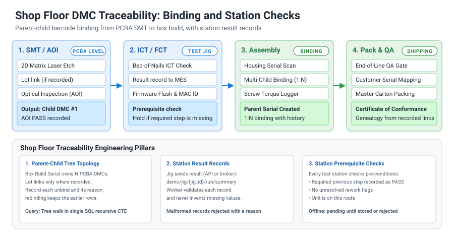
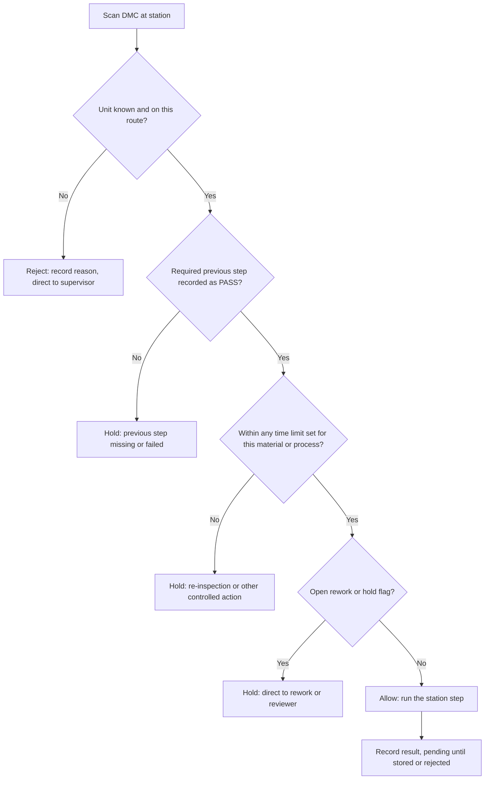

> **TL;DR** — When a finished unit contains several serialized boards, a single outer serial cannot tell you which boards went into which unit. Record each parent-child binding with its history, check prerequisite results at each station before work starts, and keep every station record pending until the central system has stored or rejected it. Genealogy can only answer questions about relationships that were actually recorded.

---


_Parent-child binding links board DMCs to the finished-unit serial. Component lot links need separate recorded data._

This is a proposed pattern, not a validated reference design. All identifiers, payload values and table names below are **fictional**. Set real limits, routes and release authority from the customer requirement, material specification and the organization's controlled process.

_Revised 2026-11-22: claims without published evidence were removed, and the schema, genealogy query and payload parser were corrected._

## Why a single outer serial is not enough

A simple product may need only one serial on the enclosure. Many electronic products contain more than one board, each with its own laser-etched or printed Data Matrix Code (DMC):

1. **Main processing board:** MCU, memory and power management.
2. **Communications board:** radio module.
3. **Power and interface board:** relays and connectors.
4. **Enclosure:** printed or laser-marked finished-unit serial.

```text
                           +-------------------------------------+
                           |  PARENT: Finished unit (fictional)  |
                           |         [ DEMO-FU-0001 ]            |
                           +------------------+------------------+
                                              |
                     +------------------------+------------------------+
                     |                        |                        |
                     v                        v                        v
          +--------------------+   +--------------------+   +--------------------+
          | CHILD: Main board  |   | CHILD: RF board    |   | CHILD: Power board |
          | [ DEMO-MB-0001 ]   |   | [ DEMO-RF-0001 ]   |   | [ DEMO-PW-0001 ]   |
          +----------+---------+   +----------+---------+   +----------+---------+
                     |                        |                        |
                     v                        v                        v
             Material lot links       Material lot links       Material lot links
             (only if recorded)       (only if recorded)       (only if recorded)
```

Suppose a problem is later suspected in one board revision or one material lot. Without a recorded binding between each board and its finished unit, the team cannot list which finished units contain the affected boards. It may then have to treat a whole date range or work order as suspect.

With bindings recorded, the team can list the candidate units. Those units are candidates for review, not confirmed defects. The size of the list depends on the evidence available: a lot recorded per placement gives a narrower set than a lot recorded only per work order.

---

## A data model for binding history

The model must support one parent with many children, a full binding history, and the reason for every unbind during rework. The example uses PostgreSQL.

```sql
CREATE EXTENSION IF NOT EXISTS btree_gist;  -- for the exclusion constraint below

-- 1. One row per physical marked item
CREATE TABLE mes_unit (
    unit_id UUID PRIMARY KEY DEFAULT gen_random_uuid(),
    barcode VARCHAR(128) NOT NULL UNIQUE,
    unit_type VARCHAR(32) NOT NULL, -- 'PCBA_CHILD', 'BOX_PARENT', 'CARTON_MASTER'
    product_sku VARCHAR(64) NOT NULL,
    work_order_id VARCHAR(64) NOT NULL,
    current_status VARCHAR(32) NOT NULL DEFAULT 'CREATED', -- 'CREATED', 'PASS', 'FAIL', 'SCRAP', 'REWORK'
    created_at TIMESTAMP WITH TIME ZONE DEFAULT CURRENT_TIMESTAMP
);

-- 2. Binding ledger: an unbind closes the row; the application never deletes rows
CREATE TABLE mes_unit_binding (
    binding_id UUID PRIMARY KEY DEFAULT gen_random_uuid(),
    parent_unit_id UUID NOT NULL REFERENCES mes_unit(unit_id),
    child_unit_id UUID NOT NULL REFERENCES mes_unit(unit_id),
    binding_station_id VARCHAR(64) NOT NULL,
    operator_badge_id VARCHAR(64) NOT NULL,
    bound_at TIMESTAMP WITH TIME ZONE NOT NULL DEFAULT CURRENT_TIMESTAMP,
    unbound_at TIMESTAMP WITH TIME ZONE, -- NULL while the binding is active
    unbind_reason VARCHAR(255),
    CHECK (parent_unit_id <> child_unit_id),
    CHECK (unbound_at IS NULL OR unbound_at > bound_at),
    CHECK (unbound_at IS NULL OR unbind_reason IS NOT NULL),
    -- A child has at most one parent at any moment, past or present.
    CONSTRAINT one_parent_at_a_time EXCLUDE USING gist (
        child_unit_id WITH =,
        tstzrange(bound_at, unbound_at, '[)') WITH &&
    )
);

-- 3. Material lot links, only where the process records them
CREATE TABLE mes_unit_material_lot (
    unit_id UUID NOT NULL REFERENCES mes_unit(unit_id),
    material_part VARCHAR(64) NOT NULL,
    lot_id VARCHAR(64) NOT NULL,
    link_basis VARCHAR(32) NOT NULL, -- 'PLACEMENT', 'FEEDER_SESSION', 'WORK_ORDER'
    recorded_at TIMESTAMP WITH TIME ZONE NOT NULL DEFAULT CURRENT_TIMESTAMP,
    PRIMARY KEY (unit_id, material_part, lot_id, link_basis)
);
```

Notes on the constraints:

- Do **not** use `UNIQUE (child_unit_id, unbound_at)` to mean "one active parent". PostgreSQL treats NULLs as distinct by default, so that constraint accepts several active rows for the same child.
- The exclusion constraint stops two bindings of the same child from overlapping in time, including two active ones.
- The schema does not stop longer loops, such as A inside B inside A. The station that binds should check for them, and the genealogy query below flags them.
- "Never deleted or rewritten" is enforced by permissions, not by the table: do not grant `DELETE` or `TRUNCATE` on the ledger to the application role, and grant `UPDATE` only on `(unbound_at, unbind_reason)`, so the role can close a binding but cannot change who was bound to what, or when. A column grant still allows a closed row to be closed again with a different time; a trigger that lets `unbound_at` change only from NULL closes that gap.
- Corrections take effect from the time they are recorded. The exclusion constraint rejects a backdated binding that overlaps an earlier one, so between a wrong scan and its correction, a point-in-time query returns the recorded (wrong) state. The reason on the closed row is what tells the reader the earlier record was wrong.

### Walking the genealogy

Two questions need different queries:

- **What is in this unit now?** Follow active bindings only.
- **What was in this unit when it shipped, or when the problem occurred?** Follow bindings that were active at that time, including ones unbound later by rework.

The query below answers the second question for a fictional unit and time (PostgreSQL 14 or later for the `CYCLE` clause):

```sql
WITH RECURSIVE unit_genealogy AS (
    SELECT u.unit_id, u.barcode, u.unit_type, 1 AS tree_depth
    FROM mes_unit u
    WHERE u.barcode = 'DEMO-FU-0001'

    UNION ALL

    SELECT child.unit_id, child.barcode, child.unit_type, ug.tree_depth + 1
    FROM mes_unit_binding b
    JOIN mes_unit child ON child.unit_id = b.child_unit_id
    JOIN unit_genealogy ug ON b.parent_unit_id = ug.unit_id
    WHERE b.bound_at <= TIMESTAMPTZ '2026-08-20 17:00+07'
      AND (b.unbound_at IS NULL OR b.unbound_at > TIMESTAMPTZ '2026-08-20 17:00+07')
) CYCLE unit_id SET is_cycle USING path
SELECT tree_depth, unit_type, barcode, is_cycle
FROM unit_genealogy
ORDER BY tree_depth, barcode;
```

If any row has `is_cycle = true`, the recorded genealogy is inconsistent. Do not use it for a decision until the binding records are corrected.

List material lot links in a separate step, for the units the query returned. Show `link_basis` and `recorded_at` with each link. `recorded_at` says when the link was recorded, not when the material was in the unit. A `WORK_ORDER` link says the lot was issued to the job. It does not prove the lot is on a particular board. A unit with no lot row means **lot link not recorded**, not "no affected material".

---

## Station prerequisite checks

Out-of-sequence work is a risk wherever a route has manual handoffs: an untested board reaches final assembly, or FCT is run on a board whose ICT result failed. A station check confirms the unit's recorded state before work starts.



### Rules for the checks

1. **Route dependency:** a step runs only when the steps the route marks as required are recorded as `PASS` for this unit.
2. **Time limits come from a source:** if a board or component has a floor-life or exposure limit, take the limit from the material specification or the applicable handling standard (for moisture-sensitive devices, for example, IPC/JEDEC J-STD-033), and record which source the station uses. Do not copy a number from another product.
3. **Failures stay visible:** a retest does not overwrite a failure. Keep first attempts and retests as separate records, and require an authorized person to route a failed unit to rework or scrap.
4. **Every refusal leaves a record:** a scan can be refused in the station screen, in the station client or by the central system. Wherever the refusal happens, record the refused value, station, time and reason there, and forward it to a place an investigation can read. Otherwise nobody can later tell whether the scan happened.

The last rule matters during a hold decision. "Not found in MES" may mean the unit never reached the station, or that it was scanned and refused before anything was sent. The [traceability hold scope method]() shows how to handle that gap.

---

## Station records: direct or through a broker

Test fixtures (ICT, FCT, RF and programming jigs) produce result summaries: pass or fail, measured values, duration and firmware version.

Stations can post results directly to a central API, or publish them to a message broker (for example MQTT) and let a worker write them to the database. A broker is one option. It can help when station networks are restricted or the central API is briefly unavailable. It also adds a component to operate and monitor. Choose it from measured load and network constraints, not by default.

```text
Topic: demo/jig/{jig_id}/run/summary
Message (fictional values):
{
  "record_id": "4f1c2b9e-0000-4000-8000-000000000001",
  "payload": {
    "jig_id": "DEMO-FCT-01",
    "barcode": "DEMO-MB-0001",
    "test_profile": "DEMO_PROFILE_A",
    "result": "PASS",
    "duration_s": 14.82,
    "vcc_mv": 3302.5,
    "current_ma": 142.1,
    "firmware_ver": "demo-1.0.0",
    "step_failures": []
  }
}
```

The station client assigns `record_id` when it queues the record, and puts it in the envelope, outside the payload. A malformed payload can then still be matched to its rejection. The central system stores the `record_id` with every accepted result and every rejected record, and returns the same answer when the same `record_id` arrives again. A message whose envelope has no usable `record_id` is stored as rejected under an identifier the central system assigns; it cannot be deduplicated, so a reviewer checks it against the station's queue.

### Validate at the boundary; do not invent values

{: .prompt-danger }
> **Edge gotcha:** Test software may write integers as floating-point numbers (`"vcc_mv": 3302.0`) or numbers as strings. Inserting those into an `INTEGER` column can fail or can round silently, depending on the value and the database driver. If the worker does not handle a failure, the record can be lost while the station believes it was sent. Store measured values as `NUMERIC`, and parse the JSON with `json.loads(raw, parse_float=Decimal)` so a value such as `0.1` is not first turned into a binary float.

Accept only formats that are clearly equivalent. Reject anything else with a reason. Never turn a missing value into `0`, or an unknown result into `FAIL`: both create a test record that did not happen.

```python
import re
from decimal import Decimal

VALID_RESULTS = {"PASS", "FAIL"}
PLAIN_DECIMAL = re.compile(r"-?[0-9]+(\.[0-9]+)?")   # ASCII digits only; no exponent, no separators

# Known test profiles and their limits (fictional values).
TEST_PROFILES = {
    "DEMO_PROFILE_A": {"max_duration_s": Decimal("3600")},
}


class RejectedPayload(Exception):
    """Store the raw payload and this reason as a rejected record."""


def _text(payload: dict, key: str) -> str:
    value = payload.get(key)
    if not isinstance(value, str) or not value.strip():
        raise RejectedPayload(f"{key} missing or not text")
    return value.strip()


def _number(payload: dict, key: str) -> Decimal:
    value = payload.get(key)
    if isinstance(value, bool) or not isinstance(value, (int, float, Decimal, str)):
        raise RejectedPayload(f"{key} missing or not a number")
    text = str(value).strip()
    if not PLAIN_DECIMAL.fullmatch(text):
        raise RejectedPayload(f"{key} is not a plain decimal: {value!r}")
    return Decimal(text)


def parse_jig_payload(payload) -> dict:
    """Validate the payload only. The record_id travels in the envelope."""
    if not isinstance(payload, dict):
        raise RejectedPayload("payload is not an object")

    test_profile = _text(payload, "test_profile")
    if test_profile not in TEST_PROFILES:
        raise RejectedPayload(f"unknown test_profile: {test_profile!r}")

    result = _text(payload, "result").upper()
    if result not in VALID_RESULTS:
        raise RejectedPayload(f"unknown result: {payload['result']!r}")
    step_failures = payload.get("step_failures")
    if not isinstance(step_failures, list):
        raise RejectedPayload("step_failures missing or not a list")
    if not all(isinstance(s, str) and s.strip() for s in step_failures):
        raise RejectedPayload("step_failures contains a non-text entry")
    if result == "PASS" and step_failures:
        raise RejectedPayload("PASS with step failures")

    duration_s = _number(payload, "duration_s")
    if not Decimal("0") < duration_s <= TEST_PROFILES[test_profile]["max_duration_s"]:
        raise RejectedPayload(f"duration_s out of range: {duration_s}")

    firmware = payload.get("firmware_ver")      # optional, but must be text if present
    if firmware is not None and not isinstance(firmware, str):
        raise RejectedPayload("firmware_ver is not text")
    return {
        "jig_id": _text(payload, "jig_id"),
        "test_profile": test_profile,
        "barcode": _text(payload, "barcode"),               # exact value; no case folding
        "result": result,
        "duration_s": duration_s,                         # NUMERIC
        "vcc_mv": _number(payload, "vcc_mv"),             # NUMERIC
        "current_ma": _number(payload, "current_ma"),     # NUMERIC
        "firmware_version": (firmware or "").strip() or None,
        "step_failures": step_failures,
        "raw_json": payload,
    }
```

A real worker would also check identifier formats against the data contract for the line. The worker stores accepted records in the result table, and stores rejected payloads, with the reason, as rejected records that someone reviews. A rejected record must not leave the unit looking tested.

---

## When the central system is unreachable

Network interruptions and server maintenance happen. The station then has two bad choices: stop work, or let units move on without a confirmed record. Which one is acceptable is a process-owner decision, not a software default.

A local queue makes the second choice safer, but only if every record's state stays visible:

```text
[ Test fixture ]
       |
       v
[ Station client ] --- (normal) ---> [ Central MES API ] ---> [ Production DB ]
       |                                     |
  (no answer)                         ACCEPTED / REJECTED
       |
       v
[ Local queue: PENDING ]
       |
  (retry until answered)
       |
       +-----------------------------> [ Central MES API ]
```

1. The station client writes each result to a local queue with its `record_id`, as **PENDING**, before sending it.
2. The central system answers **ACCEPTED** only after the record is durably stored, or **REJECTED** with a reason after storing the rejected record.
3. The client retries only PENDING records. A REJECTED record is not retried; it is shown to the operator and goes to review.
4. While anything is pending, the operator screen shows the pending count and the oldest pending time.
5. On retry, the central system recognizes a repeated `record_id` and returns the answer it gave before, instead of storing the record again.

These are the checks to verify after an outage, instead of a "zero loss" claim:

- Every `record_id` in the local queue appears exactly once in the central system, as an accepted result or a rejected record.
- The pending count returned to zero, or each remaining record has an owner.
- Units that moved on while their records were pending or rejected are listed, so a reviewer can decide whether they need a hold.

---

## Checklist

```text
[ ] 1. BINDING HISTORY, NOT ONLY CURRENT STATE
       At most one parent per child at any moment (exclusion constraint).
       Unbinds are closed with a reason; the application cannot delete rows.
       Genealogy queries flag loops.

[ ] 2. LOT LINKS SAY HOW THEY WERE RECORDED
       Placement, feeder session or work order. A missing link is reported
       as "not recorded".

[ ] 3. STATION CHECKS FROM THE CONTROLLED ROUTE
       Required previous steps, time limits from a named source, open holds.
       Every refused scan is recorded where an investigation can read it.

[ ] 4. VALIDATE STATION RECORDS; NEVER INVENT VALUES
       Only clearly equivalent formats are accepted. Missing, unknown or
       out-of-range values are rejected with a reason and reviewed.

[ ] 5. EVERY RECORD ENDS ACCEPTED OR REJECTED
       Local queue, idempotent retry by record ID, and a post-outage check
       that every record reached exactly one final state.
```

---

## Related Posts

- [A Traceability Gap on the Line: Which Units Should We Hold?]() &#8212; deciding which units to hold when a traceability record is missing.
- [Building a Production Report from MES Traceability Data]() &#8212; production reporting from MES records.
- [FCT Methodology: Turn Product Requirements into Repeatable Checks]() &#8212; functional test design for embedded hardware.
- [ICT Methodology: Select Access, Fault Checks and Evidence]() &#8212; in-circuit test fixture design and failure isolation.
- [One Pile of Goods, Five Doors — Cross-Path Idempotency in Data Integration]() &#8212; keeping a repeated record from being counted twice.
