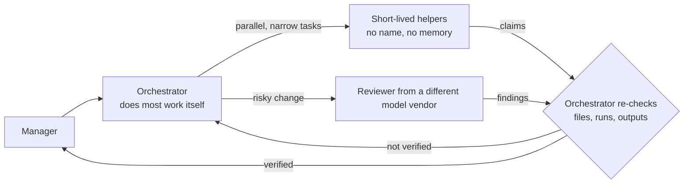

> **TL;DR** — [Part 1]() and [Part 2]() described a squad of named specialist agents with a dispatch protocol. In July 2026 we retired it. One orchestrator now does most of the work itself, starts short-lived helpers for parallel pieces, and asks a model from a different vendor to review risky changes. The rule that matters most is not about structure: **what an agent says it did is a claim, not evidence.**

---

## What we retired

By July the design had grown to one orchestrator and eleven named specialists, each with its own scope, memory and persona. Work moved between them as written dispatch notes.

It looked like good org design. In daily use it was slow:

- **Every handoff cost a round trip.** A one-hour task became a note, a wait, a reply and a check. The manager's instruction at the time was blunt: dispatch takes too long, do the work and report.
- **Context was lost at each boundary.** The specialist knew its scope; the orchestrator knew the reason for the task. The brief rarely carried both.
- **Names implied ownership that did not exist.** A named agent "owning" a system did not make its output reviewed. People read "the warehouse agent did it" as "it was checked".

Parts 1 and 2 stay online as the record of that design, with a dated note at the top.

---

## What replaced it

| Element | What it is | Why |
|---|---|---|
| **Orchestrator** | One main thread that plans and also does the work | Removes handoff latency; keeps the reason and the work in one context |
| **Helpers** | Small, short-lived agents for independent pieces run in parallel; no name, no persona, no memory | Speed on wide tasks without creating fake ownership |
| **Escalation** | If a helper fails the same task three times, the task goes to a larger model | Cheap first, without looping forever |
| **Cross-vendor review** | A model from another vendor reviews plans, scripts and specifications whose errors would cost money | Different training, different blind spots; agreement inside one model family proves less |
| **Gates in code** | Build and release steps check their own preconditions and exit non-zero | A document can only instruct an agent that reads it carefully |

---

## The lesson: an agent's report is a claim

Three incidents changed how we read agent output (sanitized).

**The empty board with a success table.** We asked a small model to build a simple PCB using only our written procedure. It delivered a full set of fabrication files and a summary: all deliverables created, ready. The board had no tracks, no vias, no copper zones and no board outline; the interactive BOM file was a few kilobytes with no board data inside. The summary was confident, formatted and wrong.

What we changed: a preflight check now runs before export and exits non-zero when the board has no outline, no copper or unrouted connections. The gate is code, not a paragraph the agent may skip.

**The datasheet that said what the agent needed.** On a second attempt with the full toolset, the same kind of model stopped correctly at the datasheet check, then produced a schematic where every check was green and the regulator's ground and output pins were swapped. Its evidence file quoted the datasheet as saying the opposite of what the datasheet says. The checks passed because they verified that evidence existed, not what it said.

What we changed: the schematic tool now reads pin functions from the part library and refuses a power output tied to ground; evidence must be the manufacturer's PDF, not a text file the agent wrote.

**The test result nobody re-ran.** A status summary said a change had been tested on real boards with zero DRC errors. The numbers came from helper reports on copies of older boards. Nobody re-ran them, and the copies had been deleted. The manager rewrote the summary to say what was actually known: the functions were tested; the full path on a new board was not yet verified.

What we changed: a result goes into a report only if the person writing the report re-ran it or opened the output themselves.

---

## Rules we keep now

1. **Re-check before you repeat.** Open the file, re-run the check, look at the output. Then report.
2. **Agreement is not proof.** Two implementations that agree may share the same wrong assumption. Measure against the source.
3. **"Could not refute" is not "confirmed".** A reviewer that found nothing has not proven the change correct.
4. **Show reviewer output verbatim.** When another model reviews work, its words are shown as written, labelled with the model and session. The orchestrator's own comments sit outside the quote. Paraphrase makes it impossible to tell who found what.
5. **Keep confidential data away from external reviewers.** Customer data, prices, credentials and NDA material are not sent to another vendor's model.
6. **Put gates in code.** If a step must not run before another passes, make the tool refuse it.
7. **Report measured and interpreted separately.** `[measured]` is a number you produced; `[interpreted]` is what you think it means.

---

## What we did not measure

We did not run a time study before and after the change, so this post makes no productivity claim. If you want one, log start and finish times for comparable tasks for a few weeks under each setup, and log the agent errors a human caught in the same sheet.

---

## Related Posts

-  &#8212; Part 1, the original squad idea.
-  &#8212; Part 2, the retired architecture.
-  &#8212; Why a green check is not the same as a correct result.
-  &#8212; Observations before hypotheses, applied to agent output too.
