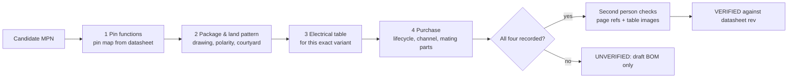

> **TL;DR** — "Same family", "same package" and "found in the library" are not evidence that a part fits the board. Before a manufacturer part number (MPN) enters a released BOM, check four things against the datasheet of that exact MPN: pin functions, package and land pattern, the electrical table that applies to that variant, and how purchasing will actually buy it. Keep the mapping `UNVERIFIED` until all four are recorded.

---

## Why the usual checks miss this

ERC compares the schematic with itself. DRC compares copper with the rules file. Netlist parity compares the board with the schematic. None of them compares the schematic with the datasheet. A pin swapped in the symbol can pass all three.

Three cases from our design reviews, using public datasheets:

### A correct pinout "corrected" into a wrong one

Two three-pin TVS protection arrays in SOT-23 sit a few millimetres apart on one of our boards. Their datasheets agree on the common pin:

| Part (datasheet, revision, section) | Pin 1 | Pin 2 | Pin 3 |
|---|---|---|---|
| PESD2CAN (Nexperia, Rev. 2, 27 Sep 2012, Table 2 Pinning) | cathode 1 | cathode 2 | **common cathode** |
| SM712 (Semtech, Revision 11/17/04, circuit diagram) | I/O 1 | I/O 2 | **GND** |

The board was first wired correctly. During a pin review the CAN array's table was misread as "pin 2 = ground", and the connection was "corrected" so that the CAN low line sat on the common pin. The review record even said the pin map matched the datasheet. Every pad still had a net, so ERC, DRC and the netlist round trip all passed. The error was found weeks later, when an independent reviewer questioned the pin table and the PDF was opened again.

Two lessons: a pin review can introduce the defect it is meant to catch, and a record that says "checked against datasheet" is only as good as the page reference and the image of the table attached to it.

### Same brand and family, different pinout per package

An addressable LED was changed from a 2020 package to a 5050 package of the same family, both four pins:

| Pin | WS2812B-2020 (Worldsemi) | WS2812B 5050 (Worldsemi) |
|---|---|---|
| 1 | DO | **VDD** |
| 2 | GND | DOUT |
| 3 | DI | **VSS** |
| 4 | VDD | **DIN** |

Re-using the old netlist would have put the supply on the data input. Pin names and numbers are from each package's own "PIN function" table.

### One datasheet, several tables

Many datasheets cover a family: different grades, temperature ranges or a newer "B" version, each with its own electrical table. In one review we quoted a limit from the table of the newer variant while the BOM held an older variant with a looser limit. The rule: quote only the table that names the MPN in the BOM, and record the page.

---

## The four checks



| Check | Record | Common miss |
|---|---|---|
| **1. Pin functions** | For every pin: number, datasheet name, function, net it connects to, datasheet page or table | Copying a symbol from a sibling part; trusting a library symbol because its name matched |
| **2. Package & land pattern** | Package drawing reference, pitch, pad size source, pin 1 and polarity mark, body and courtyard | A footprint that "fits" but is for another package code; exposed pad not connected |
| **3. Electrical table** | Which table or column applies to this MPN, with page; operating values at the real conditions (bias, temperature) | A family datasheet table for another grade; capacitor value at 0 V instead of at working bias |
| **4. Purchase** | Lifecycle status with source and date; how this customer's parts are bought; mating parts for connectors | Old order codes left after a footprint change; distributor stock read as availability |

The mapping stays `UNVERIFIED` until all four columns have an entry with a page reference, and a second person has compared the entries with the datasheet. An `UNVERIFIED` line may sit in a draft BOM, not in a released one. A blank is honest; a guessed value reads as a checked fact. `VERIFIED` means the part matches its datasheet in this design. It does not approve a substitution; that is a separate change decision.

---

## A footprint change is a purchasing change

When the pitch of a connector changes, the pads, holes and outline follow in CAD. The order code does not. In one design, terminal blocks moved to a smaller pitch while the BOM kept the order codes of the old pitch. The geometric checks passed, because the error was in the BOM, not in the geometry.

Rule: in the same edit that changes a footprint, pitch or package, walk the MPN of that reference designator. If the new part is not chosen yet, write the type and the mating part and leave the order code empty.

---

## Availability depends on how the part is bought

Distributor stock is one signal, not a verdict, and it depends on the buying channel:

- **Parts we choose ourselves:** check lifecycle live on the manufacturer's page or a major distributor before the BOM goes to purchasing, and write the source and date next to the part. A note saying "check lifecycle" is not a check.
- **Parts fixed by the customer's approved vendor list:** some customers, often in automotive, require purchase direct from the maker or an authorized channel. Zero stock at a catalogue distributor then says little; confirm lead time or allocation with the approved channel instead. A substitute is proposed only if the customer approves it and it meets their qualification requirement. For automotive parts that usually means evidence for the MPN against the applicable AEC-Q document (Q100 for ICs, Q101 for discrete semiconductors, Q200 for passives) and the required temperature grade.

---

## When a substitute is proposed

Treat it as an engineering change, not a BOM edit:

1. Run the four checks for the new MPN.
2. List differences from the released part: pins, package, table values, qualification, lifecycle.
3. Decide whether the board, the test program or the assembly program changes.
4. Record effectivity: from which build or date, and what happens to parts already in stock.

The [engineering change control]() article has the record for steps 3 and 4.

---

## Blank verification record

```
EXACT-MPN VERIFICATION
RefDes / BOM line        :
MPN / manufacturer       :
Datasheet (rev, date)    :
1 Pin map (pin, name, function, net, page):
2 Package drawing ref / pitch / pin-1 mark / exposed pad:
3 Table used (page, variant named) / values at operating conditions:
4 Lifecycle (source, date) / buying channel / mating part:
Status: UNVERIFIED | VERIFIED          Checked by / date:
```

---

## Evidence rule

A library name match is not a part match. A passed ERC/DRC/parity run does not check pin functions against the datasheet. "Same family" is a reason to look, not a reason to skip looking.

---

## Related Posts

- [BOM Lifecycle — From RFQ Stage to Active Production in the ERP]() &#8212; How a BOM line moves from quote to production.
- [Engineering Change Control: What Changes When One Component Changes?]() &#8212; Recording a substitution as a change with effectivity.
- [Is This PCB Ready for Fabrication Release? A Gated Build With a Human Hold at Every Step]() &#8212; Where this check sits in the board build (H2).
- [Supplier Capability Handoff: Turn a DFM Question into a Recorded Answer]() &#8212; Asking the supplier when the datasheet does not answer.
