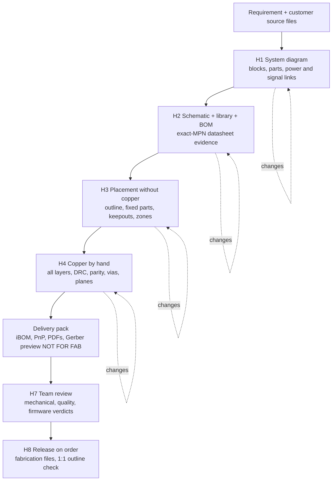

> **TL;DR** — A board passes ERC, DRC and netlist parity and can still be wrong for the customer, the buyer or the factory. We now build every board in eight steps. After each step the engineering manager reviews a fixed review pack, and nothing downstream runs until that step is passed. Fabrication files are produced only after a recorded release decision. This article describes the steps, what each review looks at, and the records that make a pass traceable.

---

## The problem: green checks, wrong board

Automatic checks answer narrow questions. ERC asks whether the schematic is electrically consistent with itself. DRC asks whether the copper respects the rules in the rules file. Parity asks whether the board matches the netlist. None of them asks:

- whether the netlist is what the product needs,
- whether the footprint matches the part that purchasing will actually buy,
- whether the layout respects why the customer drew the original board the way they did.

Three examples from our own work (sanitized):

1. **The interface that grew pins.** We redesigned a customer's sensor probe from a BOM line and two photos, without first opening their original CAD, which we already had. Our version gave the probe more connection pads than the customer's interface had. Every check passed and fabrication files had already been generated. They were put on hold when the customer's own design files were found. The interface was knowable in a minute.
2. **The footprint that changed the purchase.** Terminal blocks were moved to a smaller pitch. Pads, holes and outline followed. The BOM still carried the order codes for the old pitch. ERC 0, DRC 0, unconnected 0, parity 0 — and the parts bought from that BOM would not fit the board. No geometry check can see an error that is not in the geometry.
3. **The rule that was lowered to pass.** A repair via was placed below the board's own minimum drill and annular ring. It made the check green. It was removed and the problem solved another way. A green check bought by editing the failing rule is worth less than the red one it replaced.

The common thread: the defect sits between what the tools check and what the decision needs. A person has to look at the right thing at the right time, and the look has to be recorded.

---

## The eight steps



Each hold loops until it is passed. A change to anything a passed hold covered reopens that hold and every hold after it.

| Hold | The agent or designer produces | The reviewer looks at | Typical reasons to send it back |
|---|---|---|---|
| **H1** System | Block diagram with the parts in each block and the power and signal links | Does the architecture match the requirement and the installation site? | Missing site context (enclosure, temperature, cable entry); a block with no source for its limits |
| **H2** Schematic & library | Schematic PDF, a library page (symbol, footprint, where it came from, datasheet per part), BOM | Every non-trivial part has a pin map traced to the exact MPN's datasheet | Mapping still `UNVERIFIED`; package changed without the MPN changing; customer schematic layout not followed |
| **H3** Placement | Placement without copper: outline, fixed parts, keepouts, zoning, real part extents on both sides | Mechanical fit, hot loops, thermal zones, assembly side, test access | Parts on both sides without a reason; connector position differs from the customer drawing |
| **H4** Copper | Every copper layer, DRC, unconnected count, parity, vias, planes | Return paths, current capacity, thermal copper, angle and neck-down rules | Ground relying on a pour alone; a rule lowered to pass; 90° bends |
| **H7** Team | Delivery pack with a Gerber **preview** marked not for fabrication | Mechanical, quality and firmware owners each give a verdict | Test points missing; programming header unreachable in the fixture |
| **H8** Release | Fabrication files on an explicit order; outline measured back in millimetres at 1:1 | That the released set is the reviewed set | File set differs from the reviewed hash; scale wrong on print |

Steps 5 and 6 in our runbook are not holds: step 5 is "apply the requested changes and resubmit the same hold", and step 6 builds the delivery pack that H7 reviews.

---

## What makes a pass traceable

A verbal "looks fine" is not a pass. Each hold round is a record:

| Field | Why it exists |
|---|---|
| Hold and round number | One board can loop through H3 several times; each round is kept |
| Hash of every file the round covers | A verdict on files that changed after submission is refused |
| Who submitted, which tool or model | The submitter cannot pass their own round |
| Reviewer name and their words, verbatim | "Passed" written by someone relaying the decision is not the decision |
| Status: `passed` or `changes` | No third "mostly OK" state |

The build tool checks the record before it runs: if an earlier hold is open, the next step refuses to start. That turns the review from a habit into a gate.

Copy the blank record below for each round. Leave the reviewer fields empty until a real decision exists.

```
HOLD ROUND RECORD
Board / revision      :
Hold (H1-H8) / round  :
Submitted by / date   :
Files covered (sha256):
Questions for reviewer:
---------------------------------------------
Reviewer              :
Reviewer's words      :
Status (passed/changes):
Date                  :
```

---

## Before H1: open the customer's design first

When the job is a redesign of a customer board, the first input is not our idea of a better board. It is the customer's files.

1. **Find their CAD, Gerber and drawings** in the project archive and the received mail before drawing anything. Lock the connector pin counts, net names and mechanical datums from those files.
2. **Ask why they chose the original design.** A layout that looks inefficient is often thermal (copper spread for an LED or a regulator), mechanical (a connector position fixed by the housing) or historical (a field failure the customer already fixed). If the reason is not in the files, ask before changing it.
3. **Check our own specification and fixtures before asking the customer.** If the answer is already in the drawing, the specification or a fixture we built, a question to the customer costs them time and costs us credibility.

---

## Customer approval: one decision per item, each with an image

When a redesign goes to the customer for approval, we separate two kinds of items so each can be accepted or rejected alone:

| Type | Meaning | What the customer decides |
|---|---|---|
| **Fixed per customer drawing** | We followed their file; we show where and how | Confirm we read it correctly |
| **Proposed improvement** | We suggest a change and say why | Accept or reject this item only |

Rules we keep:

- Every item has an image from the actual CAD or review, not an illustration.
- The approval document is engineering only. Price and lead time belong in the quotation.
- If the customer's own data looks wrong, say so plainly with the evidence, as its own item.

---

## What the tools do not check for you

Keep these on the reviewer's list at every hold, because a green report does not cover them:

- A footprint, pitch or package change is also a purchasing change. Update the MPN in the same edit, or leave it blank with the type and mating part written out. A blank says "still to choose"; a wrong number reads as a checked fact.
- A package change can move pin functions. Three-pin protection arrays and regulators in different packages do not share a pinout. Check the pin map against the datasheet table for that exact MPN.
- Never lower a design rule to make a check pass.
- A visible ground pour is not proof that every ground pad is connected. Prove connectivity on the saved board after every copper edit.
- A Gerber preview is not a release. Generate fabrication files only after H8.

---

## Evidence rule

An ERC/DRC/parity pass is a machine check, not engineering closure. A passed hold is a review of a specific set of files, not production authorization. If a file changes after a hold passed, the hold is open again.

---

## Related Posts

- [NPI Stage Gates: Record the Decision for the Next Activity]() &#8212; The project-level gates this board-level flow sits inside.
- [Engineering Release Package: Are These Files Ready to Build?]() &#8212; What goes into the package after H8.
- [A DFx Finding That Someone Else Can Verify]() &#8212; How to record a finding raised at a hold.
- [Engineering Change Control: What Changes When One Component Changes?]() &#8212; What happens when a released board must change.
- [DFM Checklist for PCBA: Check the Actual Build Route]() &#8212; Manufacturability checks to apply at H3 and H4.
