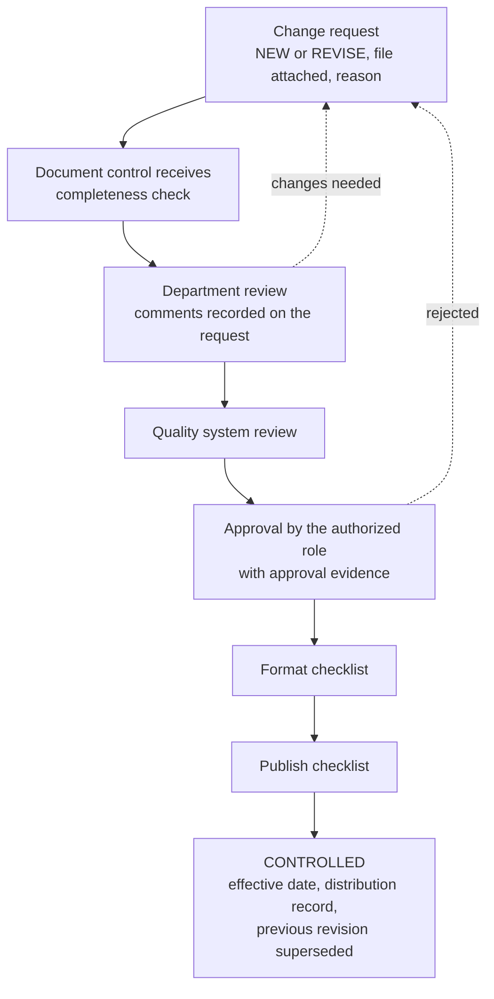

> **TL;DR** — A controlled document is released when a request, an independent review, a recorded approval and a publish check all exist for that exact revision, and every form that refers to it points at the right parent. A new file in a shared folder is not a release. We moved our ISO 56001 document work from folders into a document-control workflow and found the problems were mostly in the details: who may act on their own request, how revision labels are written, how forms attach to procedures and what happens to signed originals.

---

## What "released" means

Both ISO 9001 and ISO 56001 follow the same structure for documented information: when it is created or updated, it is reviewed and approved for suitability and adequacy (7.5.2), and it is controlled for distribution, access, version and retention (7.5.3). Check the wording in the edition you are certified to. A shared drive can meet this if a register and approval history sit beside it. In our experience a folder of files alone did not show, for a given revision:

- who asked for the change and why,
- who reviewed it, separately from who wrote it,
- who approved it and on what evidence,
- when it became effective, and which revision it replaced,
- which forms belong to it.

A workflow records these as part of the work. That was our reason to move.

---

## The release path



| Step | Who | What must exist before the next step |
|---|---|---|
| Request | Originator | The file, the type (new or revision), the reason, the affected forms |
| Receive | Document control | Request complete; document number and target revision correct |
| Review | Department head | Comments recorded on the request, not in side chats |
| QS review | Quality system | Consistency with the master list and related procedures |
| Approve | The role named in the authority table | Approval evidence (see below) |
| Format & publish | Document control | Checklists completed; previous revision marked superseded |

---

## Rules we chose and made explicit

The standards ask for review and approval; they do not prescribe the rules below. These are the choices we made and why.

**1. The requester cannot act on a step of their own request.** This is our rule, so that review is independent of authorship. We enforce it in the tool, not by trust: the account that submitted a request is refused at the review, approval and document-control steps of that request. When we prepared a batch of revisions ourselves, the document-control step had to be done by another document controller.

**2. A department with no head still needs a reviewer.** The authority table must say who reviews for a department without a head. In our case the management representative reviews for the management system's own documents. Write it down before the first request gets stuck.

**3. Approval carries evidence.** When approval happens outside the tool (for example by email from a director who does not use it), the step records the date, a message that names the document number, revision and the word "approved", and who was copied. "Approved verbally" is not recorded.

**4. One revision label format.** We found labels written as `03`, `Rev.03` and `Rev 3` in the same register. Pick one format, migrate every record, and make the tool produce it. Exact search and text sorting treat `03` and `Rev.03` as different values.

**5. Watch padding functions on revision numbers.** A code review of our own tool found a PostgreSQL `lpad(revision, 2, '0')` on the revision label. PostgreSQL documents that `lpad` truncates a string longer than the target length, so `SELECT lpad('123', 2, '0')` returns `12`. A three-digit revision would have been cut silently. Pad without truncating, or check the length first.

**6. Forms attach to their parent procedure.** A new form is registered under the request of the procedure that uses it, so a revision of the procedure lists its forms and a reviewer sees them together. A form without a parent is an orphan the next revision will miss.

**7. Distribution records need their own number series.** If distribution records borrow the number of a form, and that form number is later reassigned, two different records end up sharing one code. We give distribution records their own series (`DIST-<year>-<seq>`), independent of form numbers.

**8. Signed originals stay signed.** An approved, signed document is kept as its signed file; only unsigned drafts are reworked. A bulk formatting or conversion pass can otherwise produce unsigned copies carrying the same revision number as the signed original, which is a controlled-document conflict. Make the formatting tool refuse any file the register shows as approved.

**9. The master list is the only source of "exists".** A draft in a working folder or a second portal is not a controlled document, even if it looks finished. When a procedure cites another document, check the master list.

---

## Before you press release

```
CONTROLLED REVISION RELEASE CHECK
Document no. / title / from rev -> to rev :
Request type (NEW/REVISE) / reason       :
Requester                                :
Reviewer(s) - not the requester          :
Comments closed (count, where recorded)  :
Approver (role per authority table)      :
Approval evidence (date, message ref)    :
Revision label in register format        :
Forms linked to this procedure (list)    :
Previous revision marked superseded      :
Effective date                           :
Distribution record no.                  :
```

Leave the approver fields empty until a real approval exists.

---

## What a workflow does not do

It does not make the content right. Review is still people reading the document against how the work is actually done. It also does not replace the certification audit: the audit samples whether the system is followed, not whether a tool exists.

---

## Related Posts

- [Document-as-Code: An Offline-First Controlled Document Set for ISO 56001]() &#8212; The earlier static-file document set this workflow now controls.
- [SOP Hierarchy: When to Write a Procedure vs. a Work Instruction]() &#8212; How procedures, work instructions and forms relate.
- [SOP Revamp Playbook — 13 Principles for SOPs That Actually Get Used]() &#8212; Rewriting procedures so people can follow them.
- [Engineering Change Control: What Changes When One Component Changes?]() &#8212; The same request-review-approve logic for engineering changes.
